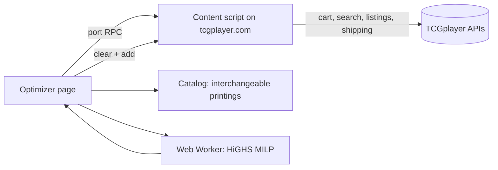

# TCGplayer Cart Optimizer

A Chrome and Firefox extension that rebuilds your TCGplayer cart for the lowest total price,
**shipping included**. Most sellers charge $1.49 under a $5 subtotal and ship free above it; buying
a whole cart from the right few sellers is usually far cheaper than buying each card at its lowest
price.

1. Put the cards you want in your TCGplayer cart (any sellers, any printings).
2. Click the toolbar button on a TCGplayer tab.
3. Review the requirements: printings with identical card text are merged automatically
   (e.g. every *Black Belt's Training*); tick **Exact printing only** for the ones you care about
   (e.g. an illustration rare).
4. **Optimize**, review the per-seller plan and the savings, then **Replace my cart with this**.

It needs no account, server, or API key: it uses TCGplayer's own website APIs from your
TCGplayer tab, solves the purchase as a mixed-integer program locally with
[HiGHS](https://highs.dev) (WebAssembly), and writes the result back to your cart. Nothing is
collected or sent anywhere else.

## How it works



- `src/tcgplayer/` — API client (runs in the content script; TCGplayer only answers page-origin
  requests). Endpoints are documented in [`docs/tcgplayer-api.md`](docs/tcgplayer-api.md).
- `src/core/rpc.ts` — typed request/progress RPC between the extension page and the content script.
- `src/catalog/` — turns cart lines into requirements. Two products are interchangeable when the
  card name and the full gameplay text (attacks, abilities, HP, weakness, …) match after
  normalization; Jumbo, World Championship deck and code-card printings are never substitutes.
- `src/solver/` — the model. Integer copies per listing, a binary "ships a package" and
  "reaches free shipping" per seller, an optional package cap, and a penalized shortfall so the
  best partial plan is still returned when stock runs out. Before solving, exact dominance rules
  drop sellers and listings that cannot be in any optimal plan (see the comments in
  `model.ts`); on a real 22-card cart this takes 28k listings / 6.8k sellers down to ~5k / ~800.
- `src/ui/` — the React page.

## Development

Requires Node 20+ and pnpm.

```sh
pnpm install
pnpm dev            # Chrome with the extension loaded and hot reload
pnpm dev:firefox    # Firefox
pnpm test           # unit tests
pnpm compile        # type-check
```

`scripts/check-fixture.ts` re-solves a captured market snapshot (kept out of git in
`.local-fixtures/`) and checks the totals against an independent PuLP/CBC model:
`bun scripts/check-fixture.ts`.

## Building and publishing

```sh
pnpm zip            # .output/tcgplayer-cart-optimizer-<version>-chrome.zip
pnpm zip:firefox    # .output/…-firefox.zip and …-sources.zip (AMO wants the sources)
```

Bump `version` in `package.json` before every store upload; both stores reject a version they have
already seen.

### Chrome Web Store

1. Register at the [Chrome Web Store developer dashboard](https://chrome.google.com/webstore/devconsole)
   (one-time US$5 fee, 2-step verification required).
2. **New item** → upload the Chrome zip.
3. Store listing: description, at least one 1280×800 screenshot, a 128×128 icon, category
   *Shopping*. Put `Source code (AGPL-3.0): https://github.com/<you>/tcgplayer-cart-optimizer`
   in the description — this is the AGPL "clear directions" to the source.
4. Privacy tab: single purpose ("optimizes the user's TCGplayer cart"); justify `storage`
   (remembers options and locked printings) and the `tcgplayer.com` host permission (reads and
   writes the user's cart, fetches listings); declare that no user data is collected; link a
   privacy policy (a short page saying exactly that is fine).
5. Submit for review (typically hours to a few days). Later updates: upload a new zip with a
   higher version.

### Firefox Add-ons (AMO)

1. Sign in at the [Add-on Developer Hub](https://addons.mozilla.org/developers/) (free).
2. **Submit a New Add-on** → *On this site* → upload the Firefox zip.
3. When asked about source code, answer **yes** and upload the `-sources.zip` (the build is
   bundled/minified, so reviewers rebuild it with `pnpm install && pnpm zip:firefox`).
4. Listing: summary, description with the source link, *Shopping* category, license
   **GNU Affero General Public License v3.0**, screenshots. Data collection is already declared
   as none in the manifest.
5. Automated validation runs immediately; human review may follow. Updates go through
   **Upload New Version**.

The add-on ID (`tcgplayer-cart-optimizer@adhithirumala.com` in `wxt.config.ts`) is permanent once
published; change it before the first upload if you want a different one.

`wxt submit` (from [publish-browser-extension](https://wxt.dev/guide/essentials/publishing.html))
can automate later uploads to both stores with API credentials.

## Limitations

- US shipping, English cards, single cards (no sealed product), seller-fulfilled items
  (TCGplayer Direct's own consolidated shipping isn't modelled).
- Listings are a snapshot: an item can sell between optimizing and replacing the cart. The result
  screen reports anything that couldn't be added in full.
- TCGplayer's APIs are undocumented and may change without notice.

## License

[AGPL-3.0-or-later](LICENSE). Not affiliated with or endorsed by TCGplayer.
